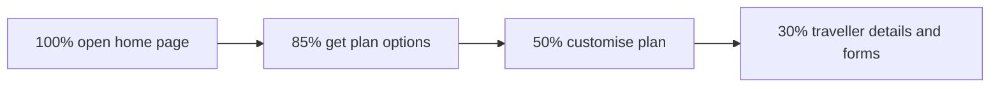

# Non-Functional Test Plan: performance of the insurance booking journey

Covers the README "Non-Functional" section. Written 2026-11-10.

**Status (2026-11-10):**
- Implemented: the journey recording, the JMeter script and the four load profiles (section 9).
- Run so far: smoke only, against the live site. It passed: 11 requests, 0 errors.
- Not run yet: baseline, load and stress. They wait for a test environment or SCTI's approval (section 2).

## 1. What the README asks for, and what it leaves open

The README asks for three things:
1. **Record** the booking journey (the same flow as the UI tests: quote → plan options → customise → traveller details
   → 1 adult, 1 dependent, 1 non-dependent).
2. A **workload model (WLM)** for **baseline, load and stress** tests.
3. A **distributed** WLM model.

It does **not** say which tool to use, the user volumes, the load profile, the response-time targets or which
environment to test. The repo has no other source for these:
- The original skeleton commit (`1714882`) contains only the text above.
- No performance tool, script or profile exists in any branch or commit.
- The only related note is in [1-ui-test-automation.plan.md](1-ui-test-automation.plan.md) section 4: the site's own
  API calls (config, create, extras, select) are the transactions to record for the WLM.

This plan therefore makes those decisions. Every number that is not measured is labelled **A1, A2, ...** (assumption)
and listed in section 11 with the question to ask SCTI.

## 2. Rules of engagement (read first)

`https://insure.scti.co.nz/` is SCTI's **live production site**, and we don't own it. Load or stress traffic sent
without the owner's permission is a denial-of-service attack. It would also create thousands of real draft quotes
and skew SCTI's marketing analytics. So:

| Test | Live site | Condition |
|---|---|---|
| Smoke (1 user, 1 journey) | Allowed | Same traffic as one UI test run (1 draft quote) |
| Baseline, load, stress | **Not allowed** | Only on a non-production environment, or with SCTI's written approval naming the maximum rate, time window, load generator IPs, contacts and abort procedure |

Always:
- Never load third-party services (Google Analytics, DoubleClick, Facebook, Taboola, Marketo, Google Maps). They are
  excluded from the scripts.
- Stop at the payment step; the journey never buys a policy.
- Send a header such as `X-Load-Test: <run id>` (if SCTI agrees) so their monitoring can separate test traffic.
- Agree how draft quotes are cleaned up (about 510 per hour of load test, section 5.3).

## 3. Tool choice: Apache JMeter

**Chosen: [Apache JMeter](https://jmeter.apache.org/) 5.6.3** (open source), installed with `brew install jmeter`.
It brings OpenJDK 21 with it.

| Need | How JMeter meets it |
|---|---|
| Record the journey | A HAR recorded by the UI test (section 4) gives every request and response; JMeter's HTTP(S) Test Script Recorder is the alternative |
| WLM with set arrival rates | **Open Model Thread Group**: an open model, so the number of new journeys per hour stays fixed even when the site slows down |
| Choose the load profile at run time | One script; the profile is a properties file passed with `-q`, which sets the arrival schedule |
| Distributed WLM | The user-type mix is built into the script (section 5.1); JMeter's remote mode, or several independent generators, spreads the load (section 6) |
| Reports | JTL results and the built-in HTML dashboard (`-e -o`): percentiles, throughput and errors per transaction |

Alternatives considered:
- **k6:** built-in pass/fail thresholds and browser users, but JMeter was chosen for this project.
- **NBomber:** keeps the language at C#, but needs a paid licence for commercial use.
- **Gatling:** strong reports, but scripts are in Scala, Java or Kotlin, a third language in this repo.
- **LoadRunner:** commercial licence.

## 4. Recording the journey

**Steps (done):**
1. The UI automation is the recorder. Set `TEST_RecordHarDir=<absolute folder>` and run the booking scenario.
   `PlaywrightHooks` then saves a full HAR (every request and response, with bodies) per scenario. The recording
   follows the README journey exactly and is re-made the same way whenever the site changes.
2. `python3 tests/PerfTests/tools/sanitize_har.py <raw.har> <output.har>` keeps only SCTI's own requests and makes
   the copy safe to commit: cookies removed, static file bodies dropped, the Google Maps key redacted.
3. The JMeter script was written from that recording (section 9):
   - static assets and third parties removed
   - requests grouped into transactions
   - correlation, test data, think times and assertions added

**HAR files hold cookies and keys.** The raw recording is kept in `tests/PerfTests/recordings/raw/`, which is
git-ignored; only the sanitized `recordings/booking-journey.har` is committed.

### 4.1 Transactions

Taken from the recorded journey (`tests/PerfTests/recordings/booking-journey.har`). One journey makes about 340
requests: 44 are the site's own static files (`/_next/static/...` and `/cdn-cgi/`, served from Cloudflare's cache),
86 are icons from `scti.co.nz`, and most of the rest are third-party analytics.

| Id | User step | Requests scripted | Measured, 1 user | Think time after (A3) |
|---|---|---|---|---|
| T01 | Open the home page | GET `/`, GET `/api/config` | 0.2–0.3 s, 0.04 s | 30 s: fill in destinations, dates and travellers |
| T02 | Get plan options | POST `/api/Quotes/create`, GET `/our-policies/comprehensive?step=plan-options` | 2.4–2.5 s, 0.15 s | 20 s: compare plans |
| T03 | Customise the plan (discount, excess, cancellation cover, extra cover) | PUT `/api/Quotes/extras`, once per change (4 in the journey) | 1.9–2.2 s each | 8 s before each change |
| T04 | Next: Traveller details | PUT `/api/Quotes/select` (the page itself changes in the browser, with no request) | 2.0–2.1 s | 30 s: eligibility and declarations |
| T05 | Fill in the 3 traveller forms | None to the site (address lookup goes to Google Maps, excluded) | – | 120 s |

**Correlation (confirmed in the recording):**
- The `create` response returns `QuoteId` and `PolicyNumber`; every `extras` and `select` call sends them back.
- It also returns the default excess (`"$200"`) and cancellation cover (`"$2,500"`). The first `extras` call sends
  them as `"200"` and `"2500"`.
- The API needs no login, session token or anti-forgery token. Only analytics cookies and `sc_site` are sent.
- Values the API accepts (seen in UI runs): excess `0`, `100` and `200`; cancellation cover `2500`, `5000` and
  `Unlimited`.

**Test data:**
- `data/journeys.csv`, pipe-separated and shared by all threads, recycled.
- Columns: destinations (ISO-3 codes), departure and return as day offsets from today, adult, dependent and
  non-dependent ages, discount, excess, cancellation cover and extra cover.
- Dates are worked out from today's date in New Zealand (`Pacific/Auckland`), whatever time zone the generator
  uses.

**Static files:** left out of the protocol scripts. Cloudflare serves them from cache, so including them would test
the CDN rather than SCTI's servers.

## 5. Workload model

### 5.1 Distributed WLM: user types (transaction mix)

Real visitors don't all finish the journey. The load is spread across four user types so each transaction gets a
realistic share.

In the script, each arrival draws a random number from 1 to 100. Nested If Controllers then send it as far as its
user type goes:
- above 15: gets a quote
- above 50: customises
- above 70: goes on to traveller details

The thresholds are properties (`funnel.quote.above`, `funnel.customise.above`, `funnel.select.above`), so a real funnel
can replace A2 without editing the script.

| User type | Share (A2) | Transactions | Session length incl. think time |
|---|---|---|---|
| S1 Browse only | 15% | T01 | about 35 s |
| S2 Quote and leave | 35% | T01, T02 | about 60 s |
| S3 Customise and leave | 20% | T01, T02, 4 × T03 | about 90 s |
| S4 Full journey | 30% | T01, T02, 4 × T03, T04, T05 (think time only) | about 240 s |



### 5.2 Volumes

- **A1:** the peak hour is **600 journeys started per hour**.
- **A4:** an average business hour is 50% of peak.

These are placeholders until SCTI supplies real figures (the site runs Google Analytics, so SCTI can export peak-hour
sessions and the funnel above).

Journeys per hour at 100% (peak):

| User type | Journeys per hour |
|---|---|
| S1 Browse only | 90 |
| S2 Quote and leave | 210 |
| S3 Customise and leave | 120 |
| S4 Full journey | 180 |

Requests per hour at 100%:

| Request | Per hour | Comes from |
|---|---|---|
| GET `/` | 600 | every journey |
| GET `/api/config` | 600 | every journey |
| POST `/api/Quotes/create` | 510 | S2, S3, S4 (85%) |
| GET plan-options page | 510 | S2, S3, S4 |
| PUT `/api/Quotes/extras` | 1,200 | S3, S4 (50%) × 4 changes |
| PUT `/api/Quotes/select` | 180 | S4 (30%) |
| **Total** | **3,600 (1 per second)** | |

**Concurrent users** (Little's law: arrival rate × average session length):
- Average session = 0.15 × 35 + 0.35 × 60 + 0.20 × 90 + 0.30 × 240 ≈ 116 s.
- At peak: 600 / 3600 × 116 ≈ **20 concurrent users**.

### 5.3 Load profiles

| Profile | Load (% of peak) | Shape | Purpose | Draft quotes created |
|---|---|---|---|---|
| Smoke | 1 S4 journey, think times × 0.1 | single run, about 3 min | Check the script works | 1 |
| **Baseline** | 50% (A4: average hour) | 10 min ramp-up, **60 min steady**, 5 min ramp-down, 5 min to finish | Reference response times and resource use under normal load; future runs are compared with it | about 255 |
| **Load** | 100% (A1: peak hour) | 10 min ramp-up, **60 min steady**, 5 min ramp-down, 5 min to finish | Prove the targets in section 7 are met at peak | about 510 |
| **Stress** | 100% → 150% → 200% → 300% → 400% | 10 min ramp-up and 10 min at 100%; then for each step a 2 min ramp and 10 min hold; then **15 min back at 100%** (recovery), 5 min ramp-down and 5 min to finish. About 95 min. | Find the breaking point (section 7), how the site fails, and whether it recovers | about 1,300 |

Concurrent users per profile: Baseline about 10, Load about 20, Stress about 80 at 400%. The Open Model Thread Group
starts one thread per arrival, so slow responses add threads rather than reducing the arrival rate.

Each profile is a file in `tests/PerfTests/jmeter/profiles/`. For example, `load.properties`:

```properties
# 10 min ramp-up, 60 min steady, 5 min ramp-down, then 5 min for journeys in progress to finish.
schedule=rate(0) random_arrivals(10 min) rate(600/hour) random_arrivals(60 min) random_arrivals(5 min) rate(0) pause(5 min)
# Never resolves, so nothing is sent until -Jhost=<approved host> is given after -q.
host=approved-test-host.invalid
```

Other settings a profile can use:
- `max.journeys`: smoke uses it to stop after exactly 1 journey.
- `funnel.min=100`: forces the full journey.
- `think.scale`: shortens or lengthens all think times.
- `run.id`: sent in the `X-Load-Test` header.
- `data.file`: a different test-data file.

All four schedules were checked with JMeter's own schedule parser.

## 6. Distributed load generation

### 6.1 Several load generators

The volumes above fit on one machine. Generators are spread out for two reasons:
- Traffic then comes from several IP addresses. Cloudflare and the site's firewall may throttle or block a single IP
  that sends a whole site's load, which would invalidate the results.
- The test proves it can scale to bigger runs.

| Option | How | When |
|---|---|---|
| **Independent generators (chosen)** | N machines each run the same script with a copy of the profile whose `rate(...)` values are divided by N (e.g. `load-3gen.properties` with `rate(200/hour)` on 3 GitHub Actions jobs or 3 VMs) | Default: simple, and no RMI ports to open between machines |
| JMeter remote mode | One controller starts the test on servers with `jmeter -n -t booking-journey.jmx -R gen1,gen2,gen3 -G profiles/load.properties`. `-G` sends the profile to every server, and each server runs the full schedule. | When the generators share a private network |
| Managed service | BlazeMeter or Azure Load Testing (both run JMX files) with load spread across regions | If a paid account is available |

- **Location (A5):** most users are in New Zealand, so generators run in an Australia or New Zealand cloud region;
  a US-hosted runner would add 150 ms or more to every request.
- **Merging results:** every generator writes its own JTL. They are merged into one HTML report with
  `jmeter -g merged.jtl -o report`, or sent live to one InfluxDB and Grafana dashboard with JMeter's Backend Listener.

### 6.2 Real browser alongside the load (hybrid)

- The existing Playwright booking scenario (`dotnet test --filter "Name~Japan"`) runs in a loop during baseline,
  load and stress. It reports what a real visitor would feel at that load, including the time to plan options.
- It doesn't add meaningful load.

## 7. Targets and pass/fail criteria

Response-time targets are **assumed (A6)** until SCTI sets them. With one user, `create`, `extras` and `select`
already take 2–2.5 s (section 4.1). The targets are therefore set just above that; tighter ones would fail before
any load.

| Measure | Target (p95 unless stated) | JMeter label |
|---|---|---|
| T01 GET `/` | < 1.5 s | `T01_Home_page` |
| T01 GET `/api/config` | < 0.5 s | `T01_Config` |
| T02 POST `/api/Quotes/create` (pricing) | < 3.5 s | `T02_CreateQuote` |
| T02 GET plan-options page | < 1.5 s | `T02_PlanOptions_page` |
| T03 PUT `/api/Quotes/extras` | < 3 s | `T03_UpdateExtras` |
| T04 PUT `/api/Quotes/select` | < 3 s | `T04_SelectPlan` |
| Failed samples (status, assertions) | < 1% | Error % in the HTML report |

Every sampler has assertions: the page is SCTI's, `create` returns `IsSuccess` true with a `QuoteId`, and `extras`
and `select` answer for the same `QuoteId`. A failed sample ends that visitor's journey (`stopthread`), as a real
visitor would give up.

**Pass or fail:**
- **Baseline:** pass if every target is met. Its results become the reference for later runs.
- **Load:** pass if every target is met for the whole steady hour, and no response time grows steadily during the
  hour (a sign of a leak).
- **Stress:** no pass or fail. The **breaking point** is the first step where a p95 is over twice its target, or
  failed requests stay above 5% for 2 minutes. Recovery passes if the targets are met again within 5 minutes of
  returning to 100%.
- **Judging the results:** JMeter has no built-in pass/fail thresholds. The targets are checked against the HTML
  report's statistics table, or in CI by reading `statistics.json` from the report folder.
- **Safety stop:** stop the run (`shutdown.sh` in JMeter's `bin`, or Ctrl+C) when the error rate passes 10%. An
  automatic stop can be added later with a JSR223 Listener.

## 8. Monitoring

| Side | What | Source |
|---|---|---|
| Client | Response times per transaction, throughput, errors, active threads | JMeter HTML dashboard; live in Grafana via the Backend Listener (InfluxDB) |
| Server | CPU, memory, database and pricing-engine response times, error logs, Cloudflare cache hits and blocks | **Needs SCTI's access** (APM and Cloudflare analytics) |

Without server-side data the tests can show that the site slowed down, but not why. Lining both up by time, and by
the `X-Load-Test` header, gives that answer.

## 9. Implementation (repo layout)

```
tests/PerfTests/
├── recordings/
│   ├── booking-journey.har       # sanitized recording of the journey (committed)
│   └── raw/                      # full recordings with cookies (git-ignored)
├── tools/sanitize_har.py         # raw HAR -> shareable HAR
└── jmeter/
    ├── booking-journey.jmx       # the script: T01–T04, funnel, correlation, assertions, think times
    ├── data/journeys.csv         # destinations, date offsets, ages, discount, excess, cancellation, extra cover
    ├── profiles/
    │   ├── smoke.properties      # 1 full journey (the only profile allowed on the live site)
    │   ├── baseline.properties   # 300 journeys/hour
    │   ├── load.properties       # 600 journeys/hour
    │   └── stress.properties     # 600 to 2,400 journeys/hour in steps
    └── results/                  # JTL files and HTML reports (git-ignored)
```

**Running** (from `tests/PerfTests/jmeter`):
- Smoke: `jmeter -n -t booking-journey.jmx -q profiles/smoke.properties -l results/smoke.jtl -e -o results/smoke-report`
- Any other profile:
  `jmeter -n -t booking-journey.jmx -q profiles/load.properties -Jhost=<approved host> -l results/load.jtl -e -o results/load-report`
- Without `-Jhost`, baseline, load and stress go to a host that never resolves, so they can't hit the live site by
  mistake. `-J` must come after `-q`, because later options win.
- To edit or debug the script, open it in the JMeter GUI (`jmeter -t booking-journey.jmx`). Enable "View Results
  Tree" while debugging, and keep it disabled for load runs.

**CI:** [.github/workflows/perf-tests.yml](../.github/workflows/perf-tests.yml), triggered **manually only**.
- **Inputs:** profile (smoke, baseline, load, stress), target host and the allowed error % (default 1).
- **Target guard:** the first step stops the run when baseline, load or stress has no host, and it always stops them
  on `insure.scti.co.nz` (in any letter case). Smoke runs against the live site.
- **Approval:** the job runs in the GitHub environment `perf`. Add required reviewers to it in the repo settings so a
  person approves each run. Only one run happens at a time (`concurrency: perf-tests`).
- **Setup:** it installs Java 21 and JMeter 5.6.3. The JMeter download is checked against its SHA-512 and cached.
- **Results:**
  - It writes a per-label table (samples, errors, median, p90, p95, p99, throughput) to the run summary.
  - The job fails when no samples ran or the error rate is above the limit.
  - The JTL, `jmeter.log` and HTML report are uploaded as `perf-results-<profile>-<run>` and kept for 30 days.
- **Location:** GitHub-hosted runners are in the US, so response times include about 150 ms or more of extra network
  delay. Use self-hosted runners in Australia or New Zealand for figures that match local users (section 6.1).

## 10. Risks

| Risk | Impact | Mitigation |
|---|---|---|
| No permission or test environment | Baseline, load and stress can't run | Section 2; ask SCTI for a staging environment sized like production |
| Cloudflare bot protection challenges JMeter (no JavaScript) | Requests get 403 or a challenge page, not real responses | The smoke run from one IP was not challenged. At higher rates, allowlist the generator IPs or have SCTI relax bot checks for the run. Page and JSON assertions fail fast on challenge pages. |
| Assumed volumes are wrong | Tests too light or too heavy | Replace A1 to A6 with Google Analytics data and agreed targets before the first load run |
| Draft quotes pile up | Pollutes SCTI's data and reports | Test environment, or an agreed clean-up by test traffic markers |
| Pricing depends on dates and ages | Response times vary with data | Same data set for every run; dates relative to today, as in the UI tests |
| Recorded API changes | Script breaks | Re-record with the UI test (section 4); smoke run before every load run |
| A small test environment | Results don't match production | Record the sizes of both environments in the report; scale with care |

## 11. Assumptions and open questions for SCTI

| Id | Assumption | Question |
|---|---|---|
| A1 | Peak hour = 600 journeys started | What are the real peak-hour sessions (Google Analytics), and the expected growth (e.g. holiday season)? |
| A2 | Funnel 100% / 85% / 50% / 30% (S1 to S4 = 15/35/20/30%) | What are the real step-to-step conversion rates? |
| A3 | Think times 30 s, 20 s, 8 s, 30 s, 120 s | Are there real time-on-step figures? |
| A4 | Average hour = 50% of peak (baseline load) | What does an average business hour look like? |
| A5 | Users mainly in New Zealand; generators in Australia or New Zealand | Where do visitors come from? |
| A6 | Response-time targets in section 7 | What targets (SLAs) does the business want? |
| Env | No test environment known | Is there a staging environment, or approval for a time window on production? |
| Mon | No server-side access | Can we see APM and Cloudflare metrics during the tests? |
